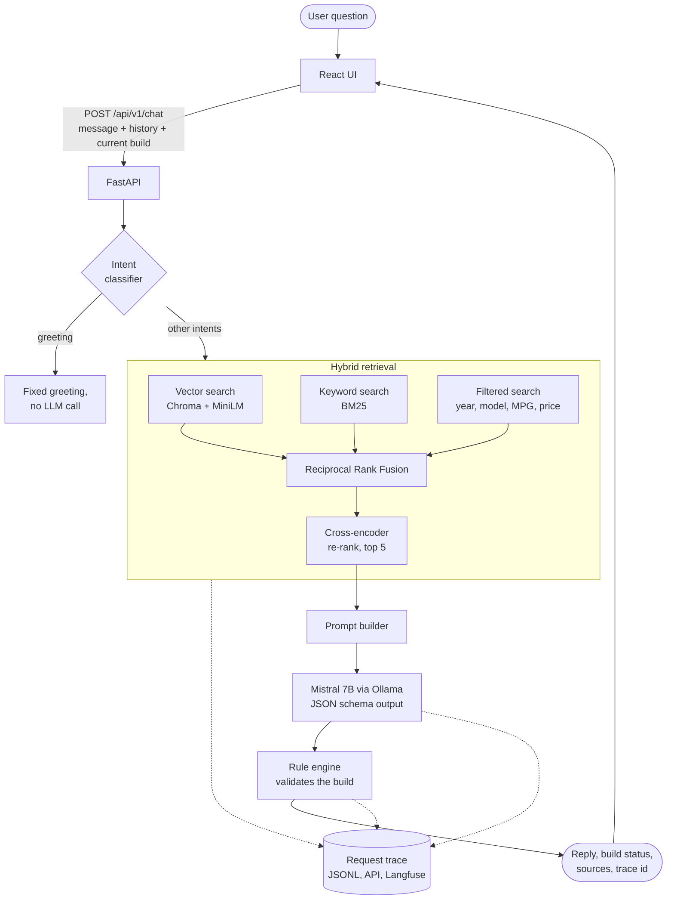
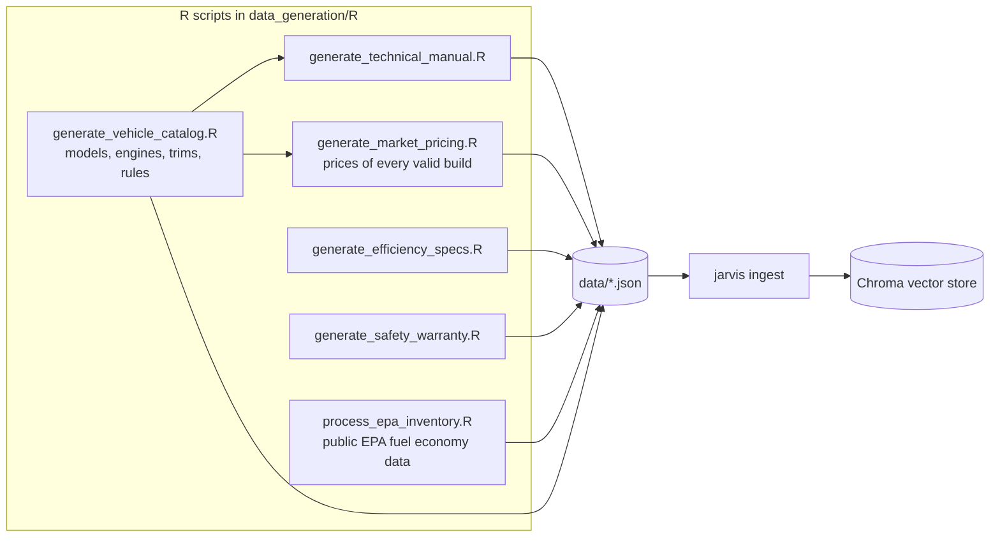

# Jarvis: Local RAG Truck Configuration Assistant


Jarvis is a chat assistant that helps customers configure a pickup truck. It answers from a local knowledge base instead of from the model's memory, checks every configuration against engineering rules in code, and shows which documents each answer was grounded on.

- **Hybrid retrieval**: vector search, BM25 keyword search and metadata-filtered search, merged with Reciprocal Rank Fusion and re-ranked by a cross-encoder.
- **Deterministic rule engine**: the language model proposes a build, but compatibility rules (for example *5.0L V8 requires the 10-Speed Automatic*) are enforced by Python code, not by the prompt.
- **Retrieval observability**: every request produces a trace with the candidates from each retrieval channel, the final context, the documents the model cited, stage timings and validation results. A golden-set evaluation measures whether the right documents are retrieved.
- **Fully local by default**: Mistral 7B through Ollama, open-source embedding and re-ranking models, Chroma as the vector store.

> **Tested setup:** I developed and tested this project on a **MacBook Pro (M1 Pro)** with **[Ollama](https://ollama.com)** running **Mistral 7B** (`ollama pull mistral`) locally.
> You can use any other model: pull it with Ollama and set `JARVIS_LLM_MODEL_NAME`, or point Jarvis at any OpenAI-compatible server (LM Studio, vLLM, llama.cpp, OpenAI) with `JARVIS_LLM_PROVIDER=openai_compatible`. See [Configuration](#configuration).

---

## How a question is answered



1. The **intent classifier** labels the question (pricing, comparison, inventory search, ...). Greetings are answered without retrieval.
2. **Hybrid retrieval** collects candidates from three channels. Structured hints in the question ("2019", "Tacoma", "under $45,000", "above 20 mpg") become Chroma metadata filters. A comparison gets one filter per vehicle, so the evidence covers both sides.
3. **Reciprocal Rank Fusion** merges the ranked lists, and the **cross-encoder** keeps the five most relevant documents.
4. The **prompt** contains the persona, grounding rules, the catalog option names, the conversation history, the current build and the retrieved documents with their ids.
5. **Mistral 7B** answers with a JSON object (reply, updated build, optional comparison, cited document ids). Ollama's structured output keeps the JSON valid.
6. The **rule engine** normalises the build to catalog names and validates it. If a rule is broken, the warning is appended to the reply even when the model forgot to mention it.
7. A **trace** of the whole request is stored and returned by id, so you can check whether the right documents were used.

## Data layer (R)

I needed data for this project, and instead of downloading a ready-made dataset I wrote the data generation in **R (RStudio)** to practise R. The scripts live in [`data_generation/`](data_generation) and write JSON files to [`data/`](data). The generated files are committed, so you only need R if you want to change the data.



| Dataset | Origin | What R does |
|---|---|---|
| `vehicle_catalog.json` | Synthetic (fictional dealership) | Defines models, engines, transmissions, trims and applications. Compatibility rules are generated from a model × engine matrix with `crossing()` + `anti_join()`. |
| `technical_manual.json` | Synthetic | Writes narrative documents from the catalog, which embed better than raw tables. |
| `market_pricing.json` | Synthetic | Enumerates every valid configuration and computes the price range of each model. |
| `efficiency_specs.json`, `safety_warranty.json` | Synthetic | Efficiency ratings, warranty and safety policies. |
| `epa_pickup_inventory.json` | Real, [EPA fuel economy data](https://github.com/rfordatascience/tidytuesday/tree/master/data/2019/2019-10-15) | Keeps 2015+ pickups, removes duplicates, keeps the latest year of each configuration and maps model names to families (`F150 Pickup 2WD` → `F-150`). |

Regenerate everything with `cd data_generation && Rscript run_all.R` (needs `dplyr`, `tidyr`, `jsonlite`, `glue`).

The knowledge base contains 223 documents: 177 EPA pickups, 13 technical guides, 13 engineering rules, 6 option descriptions, 6 pricing notes, 4 efficiency specs and 4 policies.

## Quick start

**Prerequisites:** Python 3.11+, Node.js 20+, [Ollama](https://ollama.com) 0.5 or newer (needed for JSON schema output). R is optional.

```bash
# 1. Language model
ollama pull mistral

# 2. Backend
python3 -m venv .venv && source .venv/bin/activate
pip install -r requirements-dev.txt
pip install -e .
cp .env.example .env

# 3. Build the vector store (downloads the embedding model on first run)
jarvis ingest

# 4. Start the API on http://localhost:8000 (OpenAPI docs at /docs)
jarvis serve

# 5. Start the web UI on http://localhost:5173
cd frontend && npm install && npm run dev
```

Other commands:

```bash
jarvis chat        # chat in the terminal
jarvis evaluate    # retrieval quality report on the golden set
make check         # lint, type check and tests
```

### Docker

```bash
ollama serve                      # keep Ollama on the host so it can use the Apple Silicon GPU
docker compose up --build         # API on :8000, UI on http://localhost:8080
```

The API container builds the vector store on its first start (`JARVIS_AUTO_INGEST_ON_STARTUP=true`).

## Configuration

All settings are environment variables with the `JARVIS_` prefix (see [`.env.example`](.env.example) and [`src/jarvis/config.py`](src/jarvis/config.py)).

| Variable | Default | Purpose |
|---|---|---|
| `JARVIS_LLM_PROVIDER` | `ollama` | `ollama` or `openai_compatible` |
| `JARVIS_LLM_MODEL_NAME` | `mistral` | Any model installed in Ollama, or the model name on your OpenAI-compatible server |
| `JARVIS_LLM_BASE_URL` | `http://localhost:11434` | Ollama URL, or for example `http://localhost:1234/v1` for LM Studio |
| `JARVIS_LLM_CONTEXT_WINDOW_TOKENS` | `8192` | Sent to Ollama as `num_ctx`, so the prompt is not cut off by the small default window |
| `JARVIS_EMBEDDING_MODEL_NAME` | `sentence-transformers/all-MiniLM-L6-v2` | Embedding model (re-run `jarvis ingest` after changing it) |
| `JARVIS_RERANKER_ENABLED` | `true` | Turn the cross-encoder off for faster, lower-quality ranking |
| `JARVIS_CONTEXT_DOCUMENT_COUNT` | `5` | Documents passed to the model |
| `JARVIS_LANGFUSE_ENABLED` | `false` | Also export traces to Langfuse |

## Observability and evaluation

**Request traces.** Each `/chat` call stores a trace in memory, appends it to `storage/traces/request_traces.jsonl`, and can export it to Langfuse. A trace answers the question *"did RAG fetch the right documents?"*:

| Field | Meaning |
|---|---|
| `candidates_by_channel` | Ranked hits from vector, keyword and every metadata filter, with scores |
| `fused_candidates`, `context_documents` | Ranking after fusion and after re-ranking |
| `cited_source_ids` | Documents the model says it used |
| `unknown_citation_ids` | Cited ids that were never retrieved, a hallucination signal |
| `language_model` | Provider, model, prompt size, whether the JSON reply parsed |
| `validation_status`, `violated_rule_ids` | Outcome of the rule engine |
| `stage_durations_ms` | Latency of embedding, each search, re-ranking and generation |

The web UI shows the grounding sources and the trace of the latest answer. You can also read traces through the API: `GET /api/v1/traces` and `GET /api/v1/traces/{trace_id}`.

**Retrieval evaluation.** [`evaluation/golden_set.json`](evaluation/golden_set.json) holds 28 questions with the documents that must be retrieved. `jarvis evaluate` runs them through the real retriever (no LLM involved) and reports:

- **Hit rate@k**: share of questions with at least one relevant document in the context
- **Recall@k**: share of relevant documents found (capped at k)
- **MRR**: how high the first relevant document is ranked
- **Candidate recall**: relevant documents found before re-ranking, which tells retrieval misses apart from re-ranking misses
- **Intent accuracy**: share of questions where the intent classifier picked the expected intent

During the refactor this evaluation found a real problem: questions about catalog models such as *"towing capacity of the RAM 2500"* also triggered an inventory filter on the make, which filled the context with EPA rows. Make filters are now only used for inventory searches and comparisons. A test also checks that every id in the golden set still exists, so changes in the data cannot silently break the evaluation.

**Langfuse (optional).** Run Langfuse locally ([self-hosting guide](https://langfuse.com/self-hosting)) or use Langfuse Cloud, then:

```bash
pip install -e ".[langfuse]"
export JARVIS_LANGFUSE_ENABLED=true LANGFUSE_PUBLIC_KEY=... LANGFUSE_SECRET_KEY=... LANGFUSE_BASE_URL=http://localhost:3000
```

**Logs.** Every request gets an `X-Request-ID`, which appears in each log line. Set `JARVIS_LOG_AS_JSON=true` to get JSON logs for a log collector.

## API

| Method | Path | Description |
|---|---|---|
| `POST` | `/api/v1/chat` | Ask a question. Body: `message`, `history`, `active_build`, `session_id` |
| `GET` | `/api/v1/health` | Liveness probe |
| `GET` | `/api/v1/ready` | Readiness: indexed document count and language model reachability |
| `GET` | `/api/v1/traces` | Most recent request traces |
| `GET` | `/api/v1/traces/{trace_id}` | One request trace |

The API is stateless. The client sends the conversation history and the current build with every request, so the backend can be scaled horizontally.

## Project structure

```
├── data_generation/          R scripts that produce the datasets (run_all.R runs them in order)
├── data/                     Generated JSON datasets
├── evaluation/               Golden set for retrieval evaluation
├── src/jarvis/
│   ├── domain/               Pydantic models: documents, builds, rules, conversation
│   ├── ingestion/            One loader per dataset + the knowledge base builder
│   ├── retrieval/            Embeddings, Chroma store, BM25, query analysis, fusion, re-ranking
│   ├── rules/                Catalog vocabulary and deterministic configuration validator
│   ├── generation/           LLM clients (Ollama, OpenAI-compatible), prompt builder, reply parser
│   ├── observability/        Request traces, sinks (memory, JSONL, Langfuse), stage timers
│   ├── evaluation/           Retrieval metrics on the golden set
│   ├── services/             ConfigurationAssistant: orchestrates one request
│   ├── api/                  FastAPI app, routes and schemas
│   ├── bootstrap.py          Composition root that wires all components together
│   └── cli.py                jarvis ingest | evaluate | chat | serve
├── tests/                    Unit and API tests with fake embeddings and a scripted LLM
├── frontend/                 React + TypeScript + Vite + Tailwind
├── Dockerfile, docker-compose.yml
└── .github/workflows/ci.yml  Lint, type check, tests and frontend build
```

Each component depends on small interfaces (`EmbeddingModel`, `DocumentReranker`, `ChatCompletionClient`, `TraceSink`). That is how the tests swap in fakes, and how another model provider or vector store can be added without touching the orchestration code.

## Design decisions

| Decision | Reason |
|---|---|
| RAG instead of fine-tuning | The catalog and prices change. Retrieval keeps answers current and traceable without retraining. |
| Hybrid retrieval + RRF | Embeddings miss exact tokens such as `F-150` or `5.0L`, and BM25 misses paraphrases. RRF merges the two without tuning score scales. |
| Cross-encoder re-ranking | The bi-encoder is fast for recall. The cross-encoder reads the question and the document together, which is more precise for the final five. |
| Rules in code | An LLM can ignore a prompt instruction. Safety-relevant constraints are checked deterministically and listed in the response. |
| JSON schema output | Mistral 7B is constrained by Ollama's structured output, so the UI never has to parse free text. |
| Deterministic filter extraction | Regex-based extraction of years, models, MPG and budget replaces an extra LLM call: faster, testable, and its decisions are visible in the trace. |

## Limitations and next steps

- The intent classifier is keyword-based. It is fast and transparent, but an embedding-based classifier would handle paraphrases better.
- The catalog, prices and rules are synthetic. The EPA dataset ends with model year 2020.
- Voice mode uses the browser's Web Speech API. In Chrome, speech recognition is processed by Google, so voice is the only part that does not run locally.
- The BM25 index is rebuilt in memory at startup, which is fine for hundreds of documents. A larger corpus would need a search engine with persistent keyword indexes.
- There is no authentication, because the project runs locally.
- Next steps: add answer-level evaluation (faithfulness of the reply to the cited documents) and stream tokens to the UI.

## License

[PolyForm Noncommercial 1.0.0](LICENSE): free for personal and educational use, not for commercial use.

Author: Hikmet Bozkurt Aydoğan
