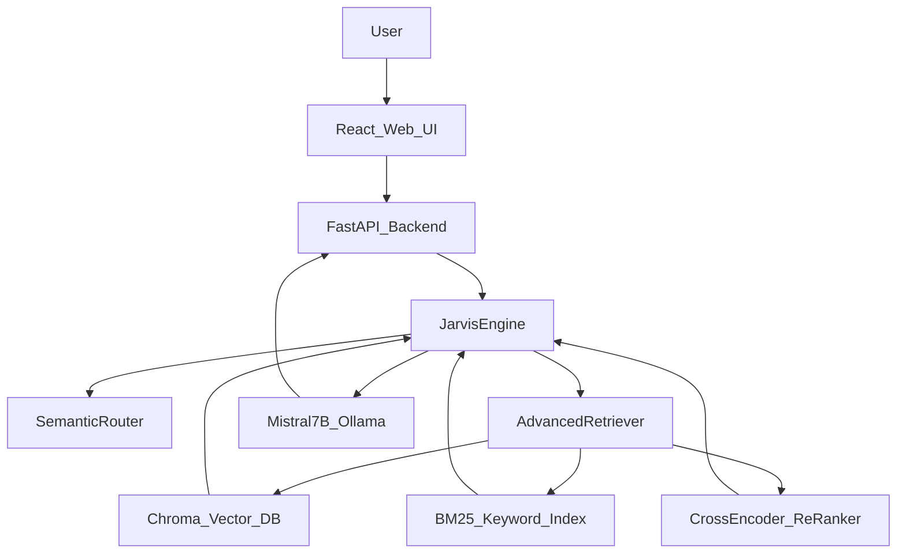

# AI‑Driven Vehicle Configuration System (Local RAG + Mistral 7B)

**Author**: Hikmet Bozkurt Aydogan  
**License**: PolyForm Noncommercial (see `LICENSE`) — personal/educational use only, no commercial use.

This repository implements a **local, AI‑driven vehicle configuration assistant** (“Jarvis”) that:
- Accepts natural language configuration requests (text + optional voice in the Web UI)
- Enforces engineering constraints and configuration rules
- Grounds answers in **retrieved knowledge** using a modern **RAG pipeline**
- Runs fully locally using **Ollama + Mistral 7B**

---

## Purpose
The goal is to build an assistant that behaves like an **expert truck configuration consultant**, but remains **grounded** in:
- A structured knowledge base (parts + rules)
- Real-world inventory records (EPA dataset processing)
- Technical documents and pricing references

This avoids hallucinations and makes the assistant suitable for realistic configuration workflows.

---

## System Architecture
The project uses a clean multi‑layer design:

- **Data Layer (R / RStudio)**  
  Generates and processes structured datasets (JSON) for parts, rules, technical narratives, and real-world inventory.

- **Orchestration Layer (Python / RAG)**  
  Handles ingestion, embeddings, hybrid retrieval, routing, and response formatting.

- **Cognitive Layer (Mistral 7B via Ollama)**  
  Performs reasoning and response generation constrained by retrieved context.

### Architecture Diagram


---

## Tech Stack
- **LLM Runtime**: Ollama + Mistral 7B (`mistral`)
- **RAG / Orchestration**: Python, LangChain, ChromaDB
- **Embeddings**: `all-MiniLM-L6-v2` (SentenceTransformers)
- **Hybrid Retrieval**: Vector search (Chroma) + keyword search (BM25)
- **Re-ranking**: Cross-Encoder re-ranker (`cross-encoder/ms-marco-MiniLM-L-6-v2`)
- **Backend**: FastAPI + Uvicorn
- **Frontend**: React + TypeScript + Vite + TailwindCSS
- **Data Processing**: R / RStudio (`dplyr`, `tidyr`, `jsonlite`)

---

## Repository Structure
- **`data_generation_R/`**: R scripts for synthetic + real-world dataset generation
- **`data/`**: Generated JSON sources (knowledge base, technical docs, inventory, etc.)
- **`src_python/`**: RAG ingestion + engine components
  - `ingest.py`: builds the vector DB
  - `router.py`: fast semantic routing (rule/keyword based)
  - `retriever.py`: hybrid retrieval (vector + BM25) + optional self-query filtering
  - `reranker.py`: cross-encoder re-ranking
  - `rag_engine.py`: end-to-end orchestration (Router → Retriever → ReRanker → LLM)
- **`web-ui/backend/`**: FastAPI backend (`/chat`) powering the web UI
- **`web-ui/frontend/`**: React UI (chat, voice mode, reasoning panel)

---

## Setup (Local)

### 1) Install Ollama + Mistral 7B
Install Ollama from `https://ollama.com` and then:

```bash
ollama pull mistral
```

You **do not** need to commit any model files to GitHub. The project is designed to download the model locally via Ollama.

---

### 2) Python Environment
From the repo root:

```bash
python3 -m venv venv
source venv/bin/activate
pip install -r requirements.txt
```

---

### 3) Generate Data (R / RStudio)
Open `data_generation_R/` in RStudio and run the scripts in a logical order:

- **`generate_specs.R`**: synthetic parts + engineering rules
- **`generate_technical_docs.r`**: narrative technical docs (RAG-friendly)
- **`generate_market_pricing.r`**, **`generate_efficiency_specs.r`**, **`generate_safety_warranty.r`**
- **`generate_master_dataset.r`**: pulls and processes external EPA dataset into `data/master_inventory.json`

All scripts write JSON into `data/`.

---

### 4) Ingest Data into the Vector Database
This builds embeddings and persists the DB locally in `db/` (ignored by git).

```bash
source venv/bin/activate
python3 src_python/ingest.py
```

---

### 5) Run the Web App

#### Backend
```bash
source venv/bin/activate
python3 web-ui/backend/main.py
```

If port 8000 is busy:
```bash
lsof -ti:8000 | xargs kill -9
```

#### Frontend
```bash
cd web-ui/frontend
npm install
npm run dev
```

Open the UI at your local Vite URL (typically `http://localhost:5173`).

---

## RAG Process (How “Training” Works Here)
This project does **not** fine-tune the model weights. Instead, it “trains” behavior and factual grounding via **RAG**:

### Step A — Data → Documents
R scripts produce structured JSON and narrative docs. Python converts these into `Document` chunks with metadata.

### Step B — Embeddings + Vector Store
`src_python/ingest.py` uses `all-MiniLM-L6-v2` embeddings and stores vectors in Chroma.

### Step C — Semantic Routing
`src_python/router.py` classifies the query quickly (comparison vs pricing vs technical vs inventory).

### Step D — Hybrid Retrieval
`src_python/retriever.py` retrieves:
- **Semantic results** from Chroma
- **Exact-match results** via BM25
Then merges + deduplicates results.

### Step E — Re-ranking
`src_python/reranker.py` re-scores candidate documents using a cross-encoder and selects the best context.

### Step F — LLM Generation
`src_python/rag_engine.py` injects context + prompts and calls Mistral via Ollama.

---

## Prompts
Prompts live in:
- `src_python/prompts/jarvis_persona.py`: persona, style rules, tone
- `src_python/prompts/system_logic.py`: engineering constraints, decision rules, comparison protocols

Jarvis responses follow a strict two-part format:
- **Internal reasoning JSON** (for UI debugging + state extraction)
- **Jarvis response** (user-facing answer)

---

## Design Notes (UI/UX)
- Fixed layout with a chat area + right-side Decision Engine panel
- Voice mode supported via browser Speech APIs (mic permission + TTS voice selection)
- Reasoning panel helps debug retrieval quality and decision logic

---

## Roadmap
- **Phase 1**: R data generation + rule modeling
- **Phase 2**: Python ingestion + embeddings + ChromaDB
- **Phase 3**: Mistral 7B cognitive layer via Ollama
- **Phase 4**: Terminal app (optional)
- **Phase 5**: Evaluation & hallucination reduction
- **Phase 6**: Voice features
- **Phase 7**: React web UI + FastAPI backend
- **Phase 8**: Multi-vehicle comparison mode
- **Phase 9 (Optional)**: Even larger-scale RAG improvements (metadata filtering, caching, multi-vector indexes)

---

## License
This project is released under the **PolyForm Noncommercial License**:
- You may **view, use, and modify** for personal/educational purposes.
- You may **not** use it for commercial purposes or resell it.

See `LICENSE` for full text.

